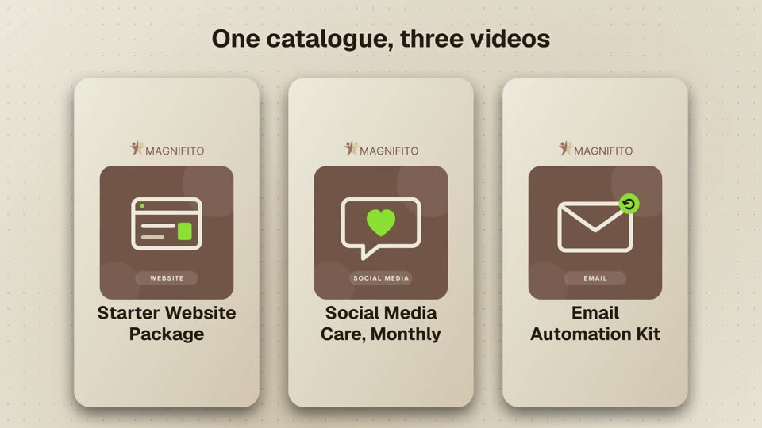
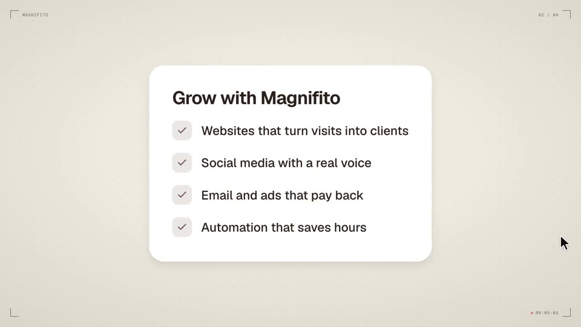
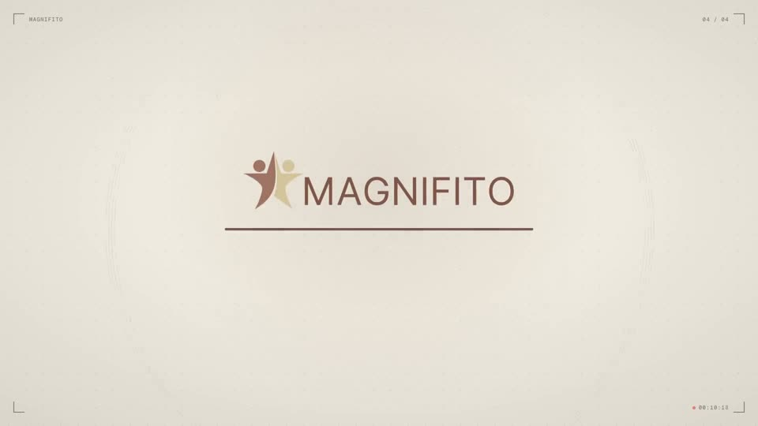
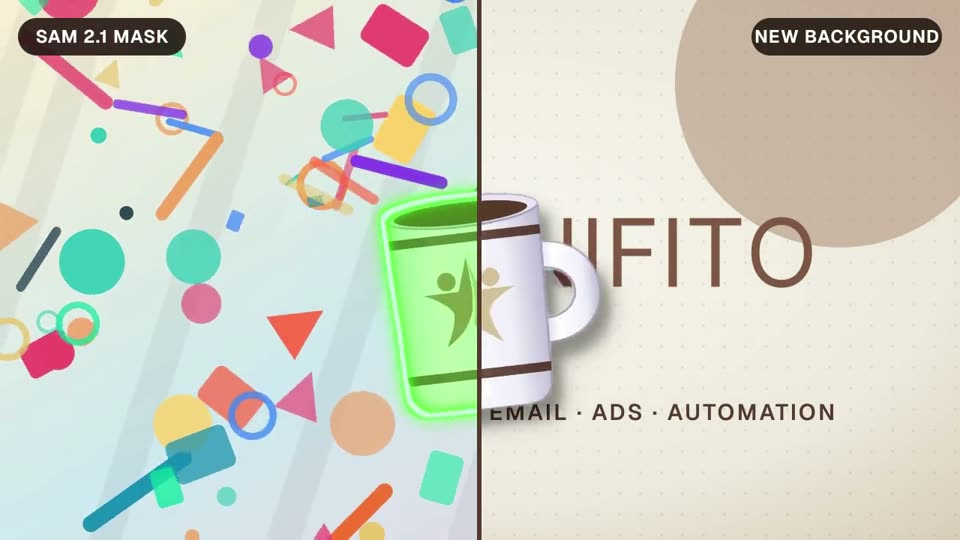
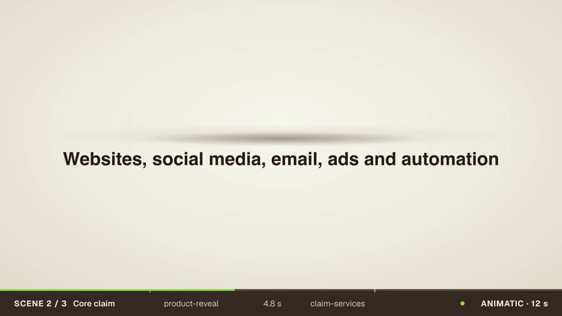

# Magnifito Super Video Repository

> Maintained video production toolkit with schema-driven contracts, pinned renderer adapters, and tracked upstreams.
> Prepared for Kiril Kirov and the Magnifito team.

## Overview

Magnifito Super Video provides an end-to-end production architecture that turns client briefs into checked storyboards, reproducible render projects, and cryptographically verified delivery packages.

External open-source motion graphics and video repositories are tracked by immutable commit hashes in an isolated registry. Production execution is mediated through **10 canonical Magnifito skills** and a deterministic CLI tool (`mgvideo`).

---

## Key Architectural Principles

1. **Schema-Driven Contracts**:
   All project inputs, brands, claims, assets, timelines, render requests, and review records follow strict, versioned schemas (`packages/contracts`). Unsupported schemas fail early.
2. **Canonical Hash Caching**:
   Render cache keys are computed strictly from canonical inputs (`brief`, `brand`, `claims`, `assets`, `scene-plan`, and render settings). Operational timestamps and run identifiers are excluded to guarantee deterministic reproducibility.
3. **Factual Claims Integrity**:
   Every visual claim, price, discount, or feature must link directly to an approved entry in `claims.json`. Modifying factual copy invalidates prior review approvals.
4. **Zero-Budget External Call Protection**:
   `media_budget_usd` defaults to `$0.00`. Paid external media or transcription APIs cannot be dispatched without explicit authorization.
5. **Dual-Timeline Preservation**:
   Original raw footage and edited timeline presentation times are tracked independently (microseconds and half-open frame intervals `[start, end)`), ensuring B-roll and transcript timing stay aligned across cuts.
6. **Strict Skill Allowlist**:
   Agent skill packager exclusively distributes the 10 canonical Magnifito skills, preventing vendor leaks and recursive discovery collisions.

---

## Repository Portfolio & Tracked Upstreams

All 15 audited repositories are tracked by immutable commit hash in `registry/upstreams.json`:

| Repository | Audited Observed Commit | License | Magnifito Production Role |
| :--- | :--- | :--- | :--- |
| **Barty Bart Motion Graphics** | `3d83d987d658601d8a1269eb691622bdcd427335` | MIT | B-roll engine & sound utilities |
| **Charlie Motion Graphics Skills**| `229022ebca76972e119e36ada23a1648d51665ab` | MIT | Creative direction & brand intake recipes |
| **HyperFrames** | `5c5794287bd0dc2c94f238ca89f4752ecaa045a2` | Apache-2.0 | **Primary Default Renderer** |
| **Video Shotcraft** | `1266a3ec4831289c4d893d42dd5102723658039a` | MIT | Shot recipes & visual rhythm |
| **Herk Edit Kit** | `10511e5af86fc47756ea89803b397422e2d89284` | MIT | Footage editing & transcript retiming |
| **Noam SaaS Product Demo** | `74f4f7150810b1bb5bf9160c4a2742c5dce69b62` | MIT | Music-led software demonstrations |
| **Official Remotion Skills** | `30d4553ecd46fbc5212fd0ff006ae43af522158b` | Remotion Co. | Isolated alternative profile (tracked) |
| **Iart B-Roll Skills** | `a51e34b0a8def533759373733bde1869c21075fb` | MIT | Speech-timed canvas overlays |
| **Iart Ecommerce Video Skills** | `2bd0dd19c9b2df5230f5d8f7453861b9681e49b4` | MIT | Retail offers & batch commerce |
| **Noam HTML Product Video** | `dfbe716495abfad263b2b8c783c21b3940b8e225` | MIT | Lightweight HTML video experimental reference |
| **Revideo** | `b5de67a009a55aa2768a1e178b0446b2479a0b4e` | MIT | Headless TypeScript framework (watchlist) |
| **Motion Canvas** | `7b91435c301d530351dcf5ebb91dd139c002e405` | MIT / GPLv3 | Vector animation framework (watchlist) |
| **VisualxIntelligence Motion Tools** | `2fae287134109449676d9afbfd38318985d75121` | MIT | Nine motion skills vendored as data: timing, render QA, beat reels, lower thirds, word-timed b-roll |
| **raea Skills** | `c507860150995eb7c22ef9db23dee636c832428a` | Apache-2.0 | Craft guides vendored as data: quality floor, P0-P3 rubric, modes, revision verbs, motion and sound numbers |
| **raea** | `d6f41c605ab71275162050cd08632cb56bd00e8a` | FSL-1.1-ALv2 | GPU engine (watchlist, ideas only): quality-check and cut-by-transcript designs, nothing copied |

---

## The 10 Canonical Magnifito Skills

1. **`magnifito-video`** (Router): Classifies jobs, validates prerequisites, coordinates specialist skills.
2. **`magnifito-brand`**: Ingests brand profile, enforces contrast, verifies Cyrillic typography support.
3. **`magnifito-storyboard`**: Converts brief and approved claims into timed, recipe-driven scene plans.
4. **`magnifito-promo`**: Renders launch films, offers, and kinetic explainers using HyperFrames.
5. **`magnifito-product-demo`**: Demonstrates real software UI flows with smooth cursor choreography.
6. **`magnifito-edit`**: Cuts and retimes video footage while preserving dual-timeline mappings.
7. **`magnifito-broll`**: Generates speech-timed transparent overlays and callouts outside the face zone.
8. **`magnifito-audio`**: Transcribes narration, ducks music, and normalizes audio to `-16.0 LUFS` / `-1.0 dBFS`.
9. **`magnifito-variants`**: Adapts layouts to `9:16`, `16:9`, `1:1`, processes Cyrillic copy, and runs commerce batches.
10. **`magnifito-deliver`**: Audits render outputs with ffprobe, verifies rights, and packages signed deliveries.

### Install the skills in Claude Code

The repository is a Claude Code plugin marketplace. Install all ten skills in one step:

```
/plugin install magnifito-video-skills --marketplace magnifito/awesome-video-skills
```

On Claude Code older than 2.1.275, add the marketplace first:

```
/plugin marketplace add magnifito/awesome-video-skills
/plugin install magnifito-video-skills@magnifito-video
```

The skills drive the `mgvideo` CLI, so install it and the media tools too:

```sh
git clone https://github.com/magnifito/awesome-video-skills && cd awesome-video-skills
npm ci && npm run build && npm link
brew install ffmpeg librsvg   # or your platform's packages
mgvideo doctor
```

Update later with `/plugin marketplace update magnifito-video`.

---

## Showcase

Eleven example videos, one per video type, made with these skills for Magnifito as the demo
client. The [showcase site](https://magnifito.github.io/awesome-video-skills/) also has a style
gallery (17 clips, one per visual recipe, `showcase/s*`), 24 format and finishing clips (one
finishing command each, `showcase/f*`) and 3 variations that render one film twice with one
setting changed (`showcase/v*`). Some cards also link the review files their run produced: a
storyboard sheet, brand checks, the `validate` and `chapters` output. The full definition is
[docs/plans/showcase-videos.md](docs/plans/showcase-videos.md).

| | | |
| :---: | :---: | :---: |
| [](showcase/01-branded-promo/)<br>Branded promo | [](showcase/02-product-demo/)<br>Product demo | [](showcase/03-talking-head-edit/)<br>Talking-head edit |
| [](showcase/04-commerce-variants/)<br>Commerce variants | [](showcase/05-multilingual-explainer/)<br>Multilingual explainer | [](showcase/06-motion-graphics/)<br>Motion graphics |
| [](showcase/07-broll/)<br>B-roll over a speaker | [](showcase/08-sound-pass/)<br>Sound pass | [](showcase/09-object-cutout/)<br>Object cut-out |
| [](showcase/10-storyboard-animatic/)<br>Storyboard animatic | [](showcase/11-ai-presenter/)<br>AI presenter (AI-generated, fictional) | |

Each folder under `showcase/` holds a `showcase.json` recipe: the prompt to give Claude Code,
the exact commands, and the config files they read. Its `README.md` shows both. To recreate an
example exactly as committed:

```sh
npm run showcase -- 06-motion-graphics   # one example
npm run showcase                         # all 55
```

The `showcase` test suite checks every recipe and runs ffprobe on every committed video. Set
`MGVIDEO_TEST_SHOWCASE=1` to re-render them all as an end-to-end test. Footage in the
talking-head, B-roll and cut-out examples is synthetic, generated by the recipe. The AI presenter
(`11-ai-presenter`) is a photoreal but fictional person generated by daVinci-MagiHuman from a text
prompt and labelled as AI-generated on screen; the clip is committed, made by
`tools/avatar/generate_mira_ai.py`, so the recipe renders without the model. Licences are in
[notices/THIRD_PARTY_NOTICES.md](notices/THIRD_PARTY_NOTICES.md).

---

## CLI Surface (`mgvideo`)

```bash
# 1. Environment & Tools Diagnostics
mgvideo doctor

# 2. Inspect Tracked Sources, Baselines & Capabilities
mgvideo catalog

# 3. Initialize a New Project Workspace
mgvideo init projects/my-promo --workflow branded-promo --language bg --duration 15

# 4. Generate Claims-Linked Scene Plan
mgvideo plan projects/my-promo

# 5. Render Video via Pinned Adapter
mgvideo render projects/my-promo --format 9:16

# 6. Validate Output Files, ffprobe Specs & Claims Verification
mgvideo validate latest --project projects/my-promo   # or a run id; --out report.txt saves the report

# 7. Package and Sign Delivery Bundle with Three-Role Sign-off & Cost Breakdown
mgvideo package <run-id> --project projects/my-promo --reviewer "Kiril Kirov"

# 8. Audit Production & Agent Costs
mgvideo cost <run-id> --project projects/my-promo

# 9. Multi-SKU Commerce Batch with Automatic Caching & Retry Tracking
mgvideo batch fixtures/commerce-batch/catalog.json

# 10. Check Tracked Upstreams for Changes (Read-only, no untrusted execution)
mgvideo upstream check

# 11. Create Candidate Proposal for Upstream Update
mgvideo upstream propose hyperframes

# 12. Roll Back an Approved Baseline
mgvideo upstream rollback hyperframes <commit-sha>
```

---

## Running Evaluations

Run the automated test suite verifying end-to-end rendering, Bulgarian Cyrillic support, factual copy revision gates, and cache reproducibility:

```bash
npm run build
npx tsx evaluations/runner.ts
```

All fixtures are stored in `fixtures/`:
- `fixtures/promo-bulgarian-15s`: 15s vertical promo with Cyrillic copy.
- `fixtures/product-demo-saas`: SaaS interface tour with feature claims.
- `fixtures/talking-head-edit`: Dual-timeline interview cut with transcript mapping.
- `fixtures/commerce-batch`: Multi-SKU commerce batch with retry states.

