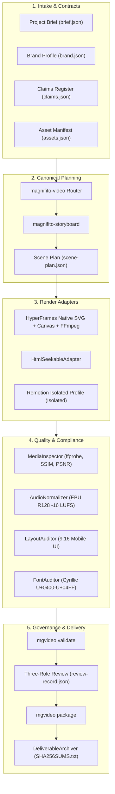

# Magnifito Super Video Architecture

This document outlines the architecture, contract system, rendering pipelines, and security boundaries of the Magnifito Super Video platform.

---

## 1. High-Level System Architecture

---

## 2. Core Packages

| Package | Path | Responsibility |
|---|---|---|
| **Contracts** | `packages/contracts` | 11 Zod schemas defining immutable data contracts (`ProjectBrief`, `BrandProfile`, `ClaimsRegister`, `AssetManifest`, `Transcript`, `EditDecisionList`, `ScenePlan`, `RenderRequest`, `RenderResult`, `ReviewRecord`, `ProjectLock`), canonical render hash computation, and migration engine. |
| **Media** | `packages/media` | Timeline rational math (`TimelineMapper`), zero-budget policy guards (`PolicyChecker`), ffprobe inspector & SSIM/PSNR video quality metrics (`MediaInspector`), EBU R128 audio loudness normalizer (`AudioNormalizer`), safe-zone auditor (`LayoutAuditor`), brand pronunciation lexicon (`BrandLexicon`), Cyrillic font auditor (`FontAuditor`), royalty-free audio catalog (`AudioCatalogManager`), localization synchronizer (`LocalizationSynchronizer`), aspect ratio re-framer (`AspectReframeEngine`), color grading presets (`ColorPresetEngine`), poster thumbnail generator (`ThumbnailGenerator`), waveform visualizer (`AudioWaveformVisualizer`), broadcast stems exporter (`StemExporter`), and production bundler (`ProductionBundleExporter`). |
| **CLI** | `packages/cli` | Unified terminal command-line tool (`mgvideo`) orchestrating production lifecycle. |
| **SDK** | `packages/sdk` | High-level async TypeScript facade (`MagnifitoVideoEngine`) for programmatic automation. |

---

## 3. Render Adapters

- **HyperFrames (Primary Production Renderer)**:
  - Generates deterministic SVG/HTML keyframes and composites them with native FFmpeg image loops and overlay filtergraphs.
  - Generates 1080x1920 vertical (9:16), 1920x1080 landscape (16:9), and square (1:1).
  - Supports transparent video with ProRes 4444 (`yuva444p10le`) and WebM VP9 (`yuva420p`).
  - Automatically tags broadcast Rec.709 color space (`-colorspace bt709 -color_primaries bt709 -color_trc bt709 -color_range tv`).
- **HTML Seekable Adapter**:
  - Fallback seekable browser timeline adapter for standalone canvas animations.
- **Remotion Isolated Profile**:
  - Pinned adapter profile for containerized React render workloads.

---

## 4. Upstream Quarantine & Audit Rules

1. **Quarantine Discovery**: Discovery scripts only inspect metadata; they **never execute untrusted code**.
2. **Immutable Commit Pinning**: All 12 external repositories are tracked in `registry/upstreams.json` by exact commit SHA.
3. **Selective Snapshotting**: Approved files are vendored into `vendor/<source-id>/<commit>/` with exact SHA-256 hashes recorded in `snapshot.manifest.json`.
4. **Instant Rollback**: Automated rollback command restores `registry/approved.lock.json` in a single command.
