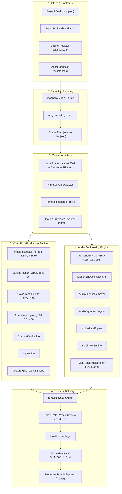
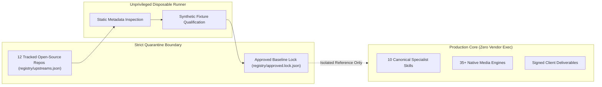

# Magnifito Super Video Architecture

This document details the system architecture, contract system, rendering pipelines, media processing engines, and security boundaries of the Magnifito Super Video platform.

---

## 1. High-Level System Architecture



---

## 2. Core Package Topology

```
awesome-video-skills/
├── packages/
│   ├── contracts/          # Immutable Zod schemas, hashes, and contract migrations
│   ├── media/              # 35+ professional audio & video post-production engines
│   ├── cli/                # mgvideo unified terminal surface (61 commands)
│   └── sdk/                # MagnifitoVideoEngine programmatic facade
├── adapters/
│   ├── hyperframes/        # Native SVG/HTML baseline renderer
│   ├── html-seekable/      # Standalone seekable canvas fallback
│   ├── remotion/           # Isolated React render adapter profile
│   └── motion-canvas/      # Type-safe 2D vector animation adapter
├── registry/
│   ├── upstreams.json      # 12 quarantined open-source repos pinned by 40-char SHA
│   ├── approved.lock.json  # Approved baseline lockfile
│   └── capabilities.json   # Canonical specialist skill mapping
├── fixtures/               # 5 canonical production workflows
└── evaluations/
    └── runner.ts           # 120 automated evaluation suites (440+ assertions)
```

---

## 3. Package Responsibilities

### `packages/contracts`
- **11 Zod Schemas**: Strict data contracts validating project inputs, runtime state, and deliverables:
  1. `ProjectBrief`: Core metadata, aspect ratios, locale, timing authority, and zero-spend budgets.
  2. `BrandProfile`: Colors, typographic hierarchy, logos, and voice guidelines.
  3. `ClaimsRegister`: Approved factual claims with evidentiary citations.
  4. `AssetManifest`: Licensed visual/audio assets with integrity hashes.
  5. `Transcript`: Speech-to-text words with millisecond timings.
  6. `EditDecisionList`: Dual-timeline cut list mapping source time to sequence frames.
  7. `ScenePlan`: Timed visual cards with claims binding.
  8. `RenderRequest`: Frozen deterministic rendering parameters.
  9. `RenderResult`: Output media specifications, frame counts, and hashes.
  10. `ReviewRecord`: Three-role human sign-off records (`creative`, `legal`, `technical`).
  11. `ProjectLock`: Cryptographic lockfile freezing inputs and dependencies.
- **Request Hashing**: Deterministic SHA-256 hash calculation across scene plan and brief.
- **Contract Migration**: Automated upgrades from legacy contracts to schema version `1.0.0`.

### `packages/media`
Houses over 35 professional media engineering engines organized into modular units:
- **Audio Engineering**:
  - `AudioNormalizer`: EBU R128 loudness normalization (`-16.0 LUFS`, `-1.0 dBTP`).
  - `SidechainDuckingEngine`: Dynamic music ducking under dialogue.
  - `AudioSilenceRemover`: Eliminates vocal dead air via `silenceremove`.
  - `AudioEqualizerEngine`: Vocal sweetening and 80Hz rumble cut (`voice-presence`, `de-ess`).
  - `NoiseGateEngine`: Ambient room hum suppression via `agate`.
  - `DeClickerEngine`: Eliminates lip-smacks and pops via `adeclick`.
  - `AudioResampler`: Native `aresample` sample rate conversion (44.1 kHz, 48 kHz, 96 kHz).
  - `AudioChannelMapper`: Channel downmixing (`mono-to-stereo`, `stereo-to-mono`).
  - `AudioPanner`: Stereo panning and soundfield widening (`extrastereo`).
  - `AudioCompressor`: Broadcast mastering dynamics compression (`acompressor`).
  - `SfxSynthesizer`: Procedural sound synthesis (whoosh, thud, pop, chime) with $0 spend.
  - `MultiTrackAudioMuxer`: Alternate audio tracks with ISO 639-2 language tags (`bul`, `eng`).
  - `AudioWaveformVisualizer`: High-res waveform visualizer PNG generation.
  - `StemExporter`: Discrete broadcast stem separation (dialogue, music, sfx, mix).
- **Video Post-Production**:
  - `MediaInspector`: ffprobe stream analysis and SSIM / PSNR visual quality diffing.
  - `ColorPresetEngine`: Curated cinematic color grading with broadcast Rec.709 metadata.
  - `AspectReframeEngine`: Aspect ratio adaptation (16:9, 9:16, 1:1, 4:5) via fit/pad.
  - `SmartCropEngine`: Focal-point biased cropping (`top` for talking heads, `center`, `left`, `right`).
  - `ChromaKeyEngine`: Green/blue screen keying and background compositing.
  - `PipEngine`: Picture-in-picture window overlay with configurable corner and padding.
  - `MatteEngine`: 2.39:1 anamorphic scope letterbox and 4:3 pillarbox bars.
  - `FreezeFrameEngine`: Start/end hold frames via native `tpad` filter cloning.
  - `BlurBackgroundEngine`: 9:16 vertical video over full-screen blurred 16:9 backdrop.
  - `CompositionGridGenerator`: Rule of Thirds and Golden Ratio guide overlays.
  - `TitleBurner`: Typographic title cards with SVG drop-shadow pill backdrops.
  - `VideoConcatEngine`: Normalized multi-clip concatenation and frame-accurate trimming.
  - `TransitionEngine`: Native FFmpeg `xfade` video transitions (fade, wipe, slide, circle).
  - `VideoSpeedEngine`: Speed multiplier (0.5x to 8.0x) with pitch-preserved audio.
  - `VideoLoopEngine`: Seamless ping-pong forward+reverse video looping.
  - `VignetteEngine`: Subtle lens edge darkening.
  - `GlitchEngine`: RGB chromatic aberration split and analog film grain noise.
  - `DeinterlaceEngine`: Progressive frame normalization via `yadif`.
  - `FrameRateConverter`: Standard framerate interpolation (24, 25, 30, 60 fps).
  - `MetadataSanitizer`: Strips GPS, camera serials, author tags, and build paths.
  - `BitrateOptimizer`: Target file size optimization for Discord, WhatsApp, and email limits.
  - `ThumbnailGenerator`: Promotional poster frames in PNG, JPG, and WebP.
  - `ProxyGenerator`: 540p / 720p low-latency editing proxies.
  - `SecurityWatermarker`: Burned-in embargo banners and reviewer identification tags.
- **Auditing & Delivery**:
  - `PolicyChecker`: Enforces `$0.00` media spend policy and retry budgets.
  - `FontAuditor`: Unicode Cyrillic (`U+0400–U+04FF`) coverage audit for Bulgarian copy.
  - `LayoutAuditor`: Mobile 9:16 platform safe-zone margin audit (TikTok, Reels, Shorts).
  - `BrandLexicon`: Phonetic pronunciation dictionary and acronym expansions.
  - `DeliverableArchiver`: Standard GNU `SHA256SUMS.txt` manifest generation.
  - `MerkleManifest`: Hierarchical binary Merkle tree root hash generation.
  - `DeliverySlaTracker`: Real-time turnaround SLA compliance monitor.

### `packages/cli`
- Unified executable `mgvideo` registering 61 production commands covering the entire project lifecycle.
- Zero dependencies on global system state; all operations are local and isolated.

### `packages/sdk`
- Programmatic TypeScript interface `MagnifitoVideoEngine` exposing all media engines, workflows, gates, and packaging APIs.

---

## 4. Execution Isolation & Quarantine Boundaries



1. **Static Review Only**: Upstream repositories are audited statically; **never execute untrusted upstream code**.
2. **Immutable Commit Pinning**: Every tracked repository is frozen to an exact 40-character commit SHA in `registry/upstreams.json`.
3. **Allowlist Packaging**: Tooling exclusively packages the 10 canonical specialist skills (`tools/packaging/packager.ts`). Vendor discovery paths are ignored.
4. **Zero-Budget Enforcement**: `PolicyChecker` throws `MEDIA_BUDGET_ZERO_VIOLATION` if any paid external API call is attempted when `media_budget_usd = 0`.
5. **Deterministic Output Caching**: Every render request produces a deterministic hash. Identical requests return verified cached artifacts without re-rendering.
