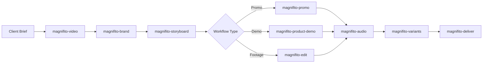

# Magnifito Video Router & Coordinator

The `magnifito-video` skill is the primary entry point for video production in the Magnifito Super Video repository. It inspects producer requests, classifies job requirements, and coordinates specialist skills through deterministic contract gates.

## Production Lifecycle



## Workflow Classification

When a user initiates video work, classify the request into one of five canonical workflows:

1. **Branded Promo (`magnifito-promo`)**:
   - Short product launches, retail offers, kinetic typography, brand teasers.
   - Requires: `brief.json`, `brand.json`, `claims.json`.
2. **Product Demo (`magnifito-product-demo`)**:
   - Software interface tours, feature walkthroughs, UI cursor animations.
   - Requires: Verified interface recordings/screenshots, feature claims.
3. **Footage Editing (`magnifito-edit`)**:
   - Talking-head cuts, interview pacing, silence removal, dual-timeline mapping.
   - Requires: Raw video recording, transcript with word timestamps.
4. **Speech-Timed B-Roll (`magnifito-broll`)**:
   - Kinetic overlays, lower thirds, callout cards timed to speech.
5. **Batch Commerce / Variants (`magnifito-variants`)**:
   - Multi-aspect ratios (16:9, 9:16, 1:1), Bulgarian/multilingual copy, SKU batches.

Also decide the mode (pitch, explain or story): what success looks like for the viewer, and which guide applies. See `reference/modes.md`, which also holds the story guide. Review notes map to named moves and the skill that owns each: `reference/moves.md`.

## Deterministic Prerequisites & Guardrails

- **Zero-Budget Default**: Media budget defaults to `$0.00`. Never call paid generative media APIs (e.g., ElevenLabs, HeyGen, Midjourney) without explicit written producer authorization.
- **Claims Register Mandatory**: Every factual statement (pricing, features, dates, accreditations) must link to an entry in `claims.json`. Never improvise factual claims during animation or scripting.
- **Active Renderer**: Defaults to `hyperframes`. Check environment health with `mgvideo doctor`.

## Stopping Conditions

- Stop and request clarification if:
  - Factual claims in the brief lack an owner, evidence source, or validation date.
  - Requested language is Bulgarian (`bg`) but no Cyrillic-capable font is registered in `brand.json`.
  - Required media assets have unclassified license or copyright status.

## CLI Coordination Surface

```bash
mgvideo doctor                # Verify worker dependencies and tools
mgvideo catalog               # Inspect available capabilities and baseline locks
mgvideo init <project-dir>    # Initialize private job workspace
mgvideo plan <project-dir>    # Generate claims-linked scene plan
mgvideo render <project-dir>  # Render frozen request to run directory
mgvideo validate [run-id]     # Assert file integrity, claims match, and ffprobe specs (default: latest run)
mgvideo package <run-id>      # Sign and assemble delivery bundle
```

